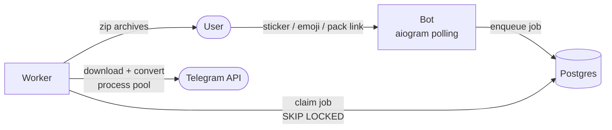

<div align="center">

# EmojiSaver

**Telegram bot that downloads custom emoji, stickers and full packs.**<br>
TGS · JSON · Lottie · PNG · GIF

[](https://t.me/EmojiSaverBot)
[](https://www.python.org/)
[](https://github.com/aiogram/aiogram)
[](https://github.com/bohd4nx/EmojiSaver/stargazers)
[](https://github.com/bohd4nx/EmojiSaver/forks)

[Features](#features) · [How it works](#how-it-works) · [Quick start](#quick-start) · [Output formats](#output-formats) · [Development](#development) · [Report a bug](https://github.com/bohd4nx/EmojiSaver/issues)

</div>

---

## Features

- Custom (premium) emoji from any message
- Stickers, sent or forwarded
- Full packs by `t.me/addstickers/…` or `t.me/addemoji/…` link
- Archives over 49 MB are split into parts
- English and Russian, set automatically and switchable with `/language`

## How it works



The bot only queues the request. The worker downloads the files, converts them in a process pool and sends the archives back. Each user can have one job in the queue at a time. Jobs interrupted by a crash are retried on restart. Delivered packs are remembered by their Telegram file ids, so asking for the same pack again is resent without downloading or converting anything; a changed pack is rebuilt.

## Quick start

```bash
git clone https://github.com/bohd4nx/EmojiSaver.git
cd EmojiSaver
cp .env.example .env        # set BOT_TOKEN
docker compose up -d
```

Compose starts Postgres, runs migrations, then starts the bot and the worker.

```bash
docker compose logs -f      # logs
docker compose restart
docker compose down         # stop
docker compose down -v      # stop and delete the database
```

## Output formats

| Source | You get                                                                          |
| ------ | -------------------------------------------------------------------------------- |
| TGS    | the original `.tgs`, `.json` (Lottie), `.lottie` (compressed), `.png` and `.gif` |
| WebM   | the original `.webm`, unchanged                                                  |
| WebP   | the original `.webp` and `.png`, or `.gif` if the sticker is animated            |

PNG is the first frame at 512×512 px, GIF is 256 px wide at up to 25 fps (animated TGS stickers are capped at 150 frames). Anything else Telegram may send is delivered unchanged. If a file can't be converted, the original is sent with a notice.

## Development

```bash
uv sync
uv run ruff check . --fix
uv run ruff format .
uv run mypy . --explicit-package-base
```
